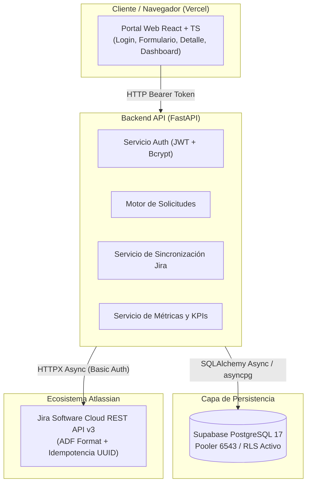

# Portal de Solicitudes Internas Integrado con Jira Cloud

[](https://fastapi.tiangolo.com/)
[](https://react.dev/)
[](https://tailwindcss.com/)
[](https://supabase.com/)
[](https://www.atlassian.com/software/jira)
[](https://docs.pytest.org/)

Solución empresarial diseñada para gestionar el ciclo de vida de incidentes y mejoras técnicas. Permite a los colaboradores registrar requerimientos desde un portal web moderno, sincroniza automáticamente el trabajo con **Jira Cloud** (mediante su REST API v3) y provee un **Dashboard de Gestión** analítico para la coordinación de TI.

Proyecto desarrollado como demostración técnica de competencias para la posición **Desarrollador Junior Integraciones con JIRA** en Haibu Solutions.

---

## 🏛️ Arquitectura del Sistema



---

## 🌟 Características Destacadas de Ingeniería

1. **Separación de Estados (Negocio vs. Integración):**
   * *Estado de Negocio:* `Recibido`, `En análisis`, `En desarrollo`, `En pruebas`, `Cerrado`, `Rechazado`.
   * *Estado de Integración:* `pendiente`, `sincronizado`, `fallido`, `reintentando`.
   * Una falla de red con Jira nunca corrompe el registro de la solicitud del usuario.
2. **Idempotencia y Resiliencia:**
   * Inyección del UUID de correlación en la descripción del ticket Jira en formato ADF (*Atlassian Document Format*).
   * Prevención estricta de tickets duplicados ante caídas de red o timeouts.
   * Registro del payload crudo de respuesta (JSONB) en la tabla `intentos_integracion` para auditoría técnica completa.
3. **Sincronización Bidireccional en Tiempo Real:**
   * Normalización de estados de Jira (español e inglés: `Backlog`, `En curso`, `Listo`, `In Progress`, etc.).
   * Actualización automática de responsable asignado en Jira (`assignee.displayName`) y cálculo de fecha de cierre.
4. **Dashboard de Gestión para Coordinadores:**
   * Cálculo de tasa de resolución en tiempo real.
   * Detección automática de **Solicitudes Estancadas** (tickets abiertos sin actualización en más de 5 días).
   * Desglose porcentual por prioridad, área y tipo de solicitud.
5. **Seguridad y Control de Acceso por Roles (RBAC):**
   * Perfil `solicitante`: Solo puede crear y visualizar sus propios requerimientos.
   * Perfil `coordinador`: Acceso global a todas las solicitudes, forzado de sincronización y métricas.

---

## 🗂️ Estructura del Repositorio

```text
jira-portal-solicitudes/
├── .codex/                     # Especificaciones técnicas (SPEC-001 a SPEC-008) y reglas
├── backend/                    # API REST asíncrona en Python
│   ├── app/
│   │   ├── api/v1/             # Endpoints (auth, solicitudes, jira, dashboard)
│   │   ├── core/               # Configuración, base de datos y seguridad JWT
│   │   ├── models/             # Modelos relacionales SQLAlchemy
│   │   ├── schemas/            # Contratos de datos Pydantic v2
│   │   └── services/           # Clientes HTTP asíncronos y lógica analítica
│   ├── migrations/             # Scripts SQL idempotentes para Supabase
│   ├── tests/                  # Suite de 223 pruebas unitarias y de integración
│   ├── requirements.txt
│   └── Dockerfile
├── frontend/                   # Single Page Application (SPA)
│   ├── src/
│   │   ├── components/         # Stepper de flujo Jira, tarjetas y badges
│   │   ├── pages/              # Login, Solicitudes, Nueva Solicitud, Dashboard
│   │   └── services/           # Cliente API con interceptor de tokens
│   ├── vercel.json             # Reglas de reescritura para Vercel
│   └── package.json
├── docker-compose.yml          # Orquestación local reproducible
└── .env.example                # Plantilla de variables de entorno
```

---

## 🚀 Puesta en Marcha Local

### Opción A: Con Docker Compose (Recomendada)

1. Clona el repositorio y crea tu archivo `.env`:
   ```bash
   cp .env.example .env
   # Completa tus credenciales de Supabase y Jira Cloud
   ```
2. Inicia todo el stack:
   ```bash
   docker compose up --build
   ```
3. Accede en tu navegador:
   * **Frontend:** [http://localhost:5173](http://localhost:5173)
   * **Backend API & Swagger:** [http://localhost:8000/docs](http://localhost:8000/docs)

### Opción B: Ejecución Manual

**Backend:**
```bash
cd backend
python -m venv .venv
# En Windows: .venv\Scripts\Activate.ps1
pip install -r requirements.txt
uvicorn app.main:app --port 8000 --reload
```

**Frontend:**
```bash
cd frontend
npm install
npm run dev
```

---

## 🧪 Pruebas Automatizadas

El proyecto incluye **223 pruebas unitarias y de integración** con `pytest` que cubren contratos de datos, roles, fallos de red simulados, formatos ADF y agregaciones del dashboard:

```bash
cd backend
pytest -v
# La suite incluye /health público, independiente de Jira y de la base de datos.
```

---

## 👥 Cuentas Demo Preconfiguradas

| Perfil | Correo Electrónico | Contraseña | Capacidades |
| :--- | :--- | :--- | :--- |
| **Solicitante** | `solicitante@empresa.com` | `Solicitante123!` | Crear requerimientos y consultar solo los propios. |
| **Coordinador** | `coordinador@empresa.com` | `Coordinador123!` | Ver todas las solicitudes, sincronizar con Jira y ver Dashboard. |

---

## ☁️ Despliegue en Producción

* **Frontend (En vivo en Vercel):** [https://portal-solicitudes-jira.vercel.app](https://portal-solicitudes-jira.vercel.app)
* **Base de Datos:** PostgreSQL gestionado en **Supabase Cloud** con connection pooler (`6543`) y políticas de seguridad RLS.
* **Integración:** Jira Software Cloud REST API v3 ([portal-solicitudes-dev.atlassian.net](https://portal-solicitudes-dev.atlassian.net)) con autenticación basada en API Tokens seguros.


### Preparación del backend para Render

El manifiesto `render.yaml` define el servicio Docker y su comprobación pública
`GET /health`. Usa `backend/` como contexto de construcción, conforme a las rutas
`COPY` del Dockerfile. El endpoint devuelve el entorno configurado en `ENVIRONMENT`
(`production` en Render) y comprueba que la aplicación responde; no consulta
PostgreSQL ni Jira.

Al crear el servicio, configura `DATABASE_URL`, `JIRA_INSTANCE_URL`,
`JIRA_USER_EMAIL` y `JIRA_API_TOKEN` como secretos en Render. El manifiesto genera
`JWT_SECRET_KEY` y permite el origen público de Vercel y `http://localhost:5173`;
ajusta `ALLOWED_ORIGINS` si cambia la URL del frontend. Después de desplegar el
backend, configura `VITE_API_URL=https://<servicio>.onrender.com/api/v1` en Vercel
y vuelve a compilar el frontend. Añadir el manifiesto no despliega el servicio.

### Mejoras de interfaz (SPEC-006)

El Dashboard incorpora gráficos de dona por estado y barras por área con Recharts,
con leyendas y datos accesibles. Las cargas de solicitudes e indicadores usan
skeletons. Sonner muestra los resultados de creación y sincronización, incluidos
los fallos parciales; las notificaciones de un ticket incluyen un botón a Jira.
El selector Sol/Luna del Navbar guarda la preferencia en `localStorage.theme` y,
si no hay una preferencia guardada, sigue el tema del sistema.

Las versiones instaladas conforme a la especificación son Sonner 1.7.4 y Recharts
2.15.4. npm señala que la rama 2 de Recharts dejó de mantenerse; una actualización
a v3 requiere revisar la compatibilidad en un incremento posterior.


### Webhooks y adjuntos (SPEC-007)

- El webhook `POST /api/v1/webhooks/jira` recibe eventos `jira:issue_updated` y
  actualiza estado, responsable, fechas y auditoría en una sola transacción.
  Configura `JIRA_WEBHOOK_SECRET` en el backend y en el emisor, mediante la
  cabecera `X-Webhook-Secret` o `?token=...`. Prefiere la cabecera cuando sea
  posible; si usas query, configura la redacción de tokens en los logs del proxy.
  Sin secreto configurado se rechazan los eventos. El navegador muestra los
  nuevos datos al volver a consultar la solicitud; no se añaden WebSockets.
- El formulario admite selección o arrastre de PNG, JPEG, PDF y TXT, hasta
  10 MiB por archivo, con previews de imágenes. Después de crear el ticket,
  envía los archivos a Jira en multipart, sin reintentos automáticos. Un fallo
  conserva la solicitud y permite recuperar localmente los archivos no confirmados.
- Los endpoints `GET/POST /api/v1/solicitudes/{id}/adjuntos` y
  `GET /api/v1/solicitudes/{id}/adjuntos/{adjunto_id}/descarga` requieren JWT y
  permisos del autor o coordinador. Las descargas pasan por FastAPI; Jira conserva
  los binarios y PostgreSQL los metadatos.

Antes de usar adjuntos en un entorno existente, aplica manualmente
`backend/migrations/002_add_adjuntos_table.sql` después de `001_initial_schema.sql`
con la conexión autorizada para migraciones. La migración y el registro del
webhook en Jira **no se ejecutaron contra servicios reales** durante estas pruebas.
El manifiesto de Render incluye el nuevo secreto externo.

Los errores, permisos y límites complementarios están documentados en
[Contratos de SPEC-007](docs/SPEC-007-contratos-complementarios.md). La comprobación
multipart y los eventos se prueban con dobles HTTP y SQLite; la subida a un ticket
real y la latencia de Supabase quedan pendientes de validación en el entorno cloud.


### Comentarios bidireccionales (SPEC-008)

El detalle incluye un timeline con autor, fecha, badges Portal/Jira y formulario
(2–2000 caracteres). GET y POST `/api/v1/solicitudes/{id}/comentarios` mantienen
los permisos del autor y del coordinador. El POST guarda primero en PostgreSQL y
publica en Jira usando ADF. Si falla el envío, conserva el comentario local y la
interfaz avisa «Guardado solo en el portal», sin repetir el POST automáticamente.

Al consultar o actualizar el timeline se recorren las páginas de comentarios de
Jira y se importan los públicos con sus fechas originales. El ID remoto y una
propiedad con el UUID local evitan ecos y permiten reconciliar envíos inciertos.
Un fallo de consulta devuelve la copia local con un aviso. Los comentarios con
visibilidad restringida no se importan. No se sincronizan ediciones ni borrados
generales en esta etapa.

Para activarlo en un entorno existente, aplica
`backend/migrations/003_add_comentarios_table.sql` con la conexión autorizada de
migraciones. La cuenta técnica de Jira necesita permisos para leer y añadir
comentarios. La migración no se aplicó en Supabase ni se publicaron comentarios
reales durante la verificación: se usaron SQLite y dobles HTTP.

Los contratos de errores, sincronización y permisos se detallan en
[Contratos de SPEC-008](docs/SPEC-008-contratos-complementarios.md).
