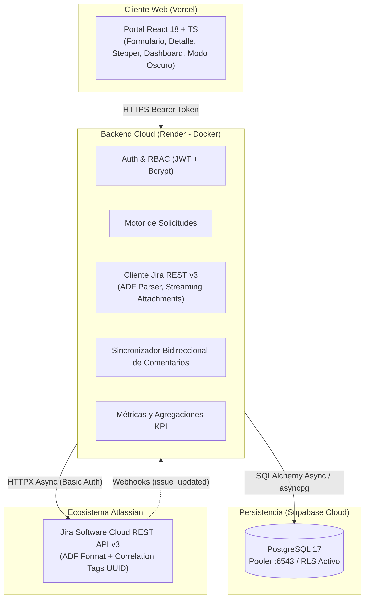

# Portal de Solicitudes Internas Integrado con Jira Cloud

[](https://jira-portal-solicitudes.onrender.com/health)
[](https://portal-solicitudes-jira.vercel.app)
[](https://fastapi.tiangolo.com/)
[](https://react.dev/)
[](https://tailwindcss.com/)
[](https://supabase.com/)
[](https://www.atlassian.com/software/jira)
[](https://docs.pytest.org/)

Solución empresarial diseñada para gestionar el ciclo de vida completo de requerimientos técnicos e incidentes. Permite a colaboradores sin licencia de Atlassian registrar solicitudes y adjuntar documentación desde un portal web moderno, sincroniza automáticamente el trabajo con **Jira Cloud** (vía REST API v3) y provee un **Dashboard de Gestión Analítico** con métricas operativas en tiempo real.

---

## 🌐 Despliegue en la Nube (Producción 24/7)

| Servicio | URL Pública | Estado |
| :--- | :--- | :--- |
| **Frontend Web (Vercel)** | [https://portal-solicitudes-jira.vercel.app](https://portal-solicitudes-jira.vercel.app) | 🟢 Live |
| **Backend API (Render)** | [https://jira-portal-solicitudes.onrender.com/health](https://jira-portal-solicitudes.onrender.com/health) | 🟢 Live |
| **Documentación Swagger** | [https://jira-portal-solicitudes.onrender.com/docs](https://jira-portal-solicitudes.onrender.com/docs) | 🟢 Live |
| **Instancia Jira Cloud** | `https://portal-solicitudes-dev.atlassian.net` (Proyecto `SOL`) | 🟢 Conectado |

### 🔑 Credenciales de Acceso Demo (1-Click en el Login)
* **Rol Solicitante:** `solicitante@empresa.com` / `Solicitante123!`
* **Rol Coordinador:** `coordinador@empresa.com` / `Coordinador123!`

---

## 🏛️ Arquitectura del Sistema



---

## 🌟 Características Destacadas de Ingeniería

1. **Atlassian Document Format (ADF):** Generación y parseo nativo del árbol JSON semántico tipado que exige Jira Cloud v3 para descripciones y comentarios enriquecidos.
2. **Idempotencia y Resiliencia:** Inyección de UUIDs de correlación (`[CORRELATION_ID: <uuid>]`) en los tickets de Jira, previniendo duplicados ante caídas o reintentos de red.
3. **Desacoplamiento de Estados:**
   * *Estado de Negocio:* `Recibido`, `En análisis`, `En desarrollo`, `En pruebas`, `Cerrado`, `Rechazado`.
   * *Estado de Integración:* `pendiente`, `sincronizado`, `fallido`, `reintentando`.
4. **Comentarios Bidireccionales (SPEC-008):** Hilo unificado entre el portal y Jira Cloud, importando comentarios públicos de los desarrolladores y permitiendo réplicas desde el portal.
5. **Streaming Seguro de Archivos Adjuntos (SPEC-007):** Carga multipart hacia Jira con cabeceras `X-Atlassian-Token: no-check` y descarga mediante proxy streaming en FastAPI, permitiendo a usuarios sin licencia de Atlassian visualizar archivos sin exponer tokens del sistema.
6. **Dashboard Operativo con KPIs en Tiempo Real:** Métricas de solicitudes estancadas (> 5 días), tasa de resolución, gráficos de distribución por estado (Donut Chart) y área (Bar Chart) con Recharts.
7. **Suite Exhaustiva de Pruebas:** **223 pruebas automatizadas** en `pytest` cubriendo autenticación, contratos Pydantic v2, normalización de transiciones y mocks de red. Cero errores de compilación TypeScript (`tsc --noEmit`).

---

## 🗂️ Estructura del Repositorio

```text
jira-portal-solicitudes/
├── .codex/                     # Especificaciones técnicas de arquitectura (SPEC-001 a SPEC-008)
├── backend/                    # API REST asíncrona en FastAPI
│   ├── app/
│   │   ├── api/v1/             # Endpoints (auth, solicitudes, comentarios, adjuntos, webhooks, dashboard)
│   │   ├── core/               # Configuración (Pydantic Settings), DB Engine y Seguridad JWT
│   │   ├── models/             # Modelos SQLAlchemy (usuarios, solicitudes, comentarios, adjuntos)
│   │   ├── schemas/            # Esquemas de validación y serialización Pydantic v2
│   │   └── services/           # Cliente Jira REST v3, normalizador de estados y métricas
│   ├── migrations/             # Migraciones SQL idempotentes para Supabase (001 a 003)
│   ├── tests/                  # 223 pruebas unitarias y de integración (Pytest)
│   ├── Dockerfile
│   └── requirements.txt
├── frontend/                   # Single Page Application (SPA)
│   ├── src/
│   │   ├── components/         # Stepper de estados, comentarios, adjuntos, gráficos y toasts
│   │   ├── pages/              # Login, Solicitudes, Nueva Solicitud, Dashboard
│   │   ├── services/           # Cliente HTTP con Axios e interceptores JWT
│   │   └── types/              # Contratos TypeScript sincronizados con Pydantic
│   ├── Dockerfile
│   ├── package.json
│   └── vercel.json
├── docker-compose.yml          # Entorno local reproducible en un comando
└── render.yaml                 # Manifiesto de infraestructura como código para Render
```

---

## 🧪 Ejecución de Pruebas Automatizadas

```bash
cd backend
.\.venv\Scripts\pytest.exe backend/tests -v
# ============================ 223 passed in 45s =============================
```

---

## 🚀 Puesta en Marcha Local

### Opción A: Con Docker Compose

```bash
docker compose up --build
```
* **Frontend:** [http://localhost:5173](http://localhost:5173)
* **Backend API & Swagger:** [http://localhost:8000/docs](http://localhost:8000/docs)

### Opción B: Ejecución Manual

**Backend:**
```bash
cd backend
python -m venv .venv
.\.venv\Scripts\Activate.ps1
pip install -r requirements.txt
uvicorn app.main:app --port 8000 --reload
```

**Frontend:**
```bash
cd frontend
npm install
npm run dev
```

---

## 📄 Licencia y Créditos
Desarrollado como proyecto de demostración de alto nivel técnico para postulaciones e integraciones con el ecosistema Atlassian.
