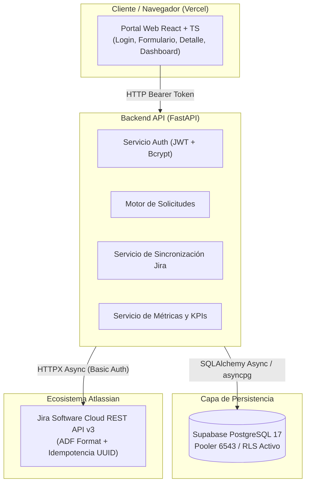

# Portal de Solicitudes Internas Integrado con Jira Cloud

[](https://fastapi.tiangolo.com/)
[](https://react.dev/)
[](https://tailwindcss.com/)
[](https://supabase.com/)
[](https://www.atlassian.com/software/jira)
[](https://docs.pytest.org/)

Solución empresarial diseñada para gestionar el ciclo de vida de incidentes y mejoras técnicas. Permite a los colaboradores registrar requerimientos desde un portal web moderno, sincroniza automáticamente el trabajo con **Jira Cloud** (mediante su REST API v3) y provee un **Dashboard de Gestión** analítico para la coordinación de TI.

Proyecto desarrollado como demostración técnica de competencias para la posición **Desarrollador Junior Integraciones con JIRA** en Haibu Solutions.

---

## 🏛️ Arquitectura del Sistema



---

## 🌟 Características Destacadas de Ingeniería

1. **Separación de Estados (Negocio vs. Integración):**
   * *Estado de Negocio:* `Recibido`, `En análisis`, `En desarrollo`, `En pruebas`, `Cerrado`, `Rechazado`.
   * *Estado de Integración:* `pendiente`, `sincronizado`, `fallido`, `reintentando`.
   * Una falla de red con Jira nunca corrompe el registro de la solicitud del usuario.
2. **Idempotencia y Resiliencia:**
   * Inyección del UUID de correlación en la descripción del ticket Jira en formato ADF (*Atlassian Document Format*).
   * Prevención estricta de tickets duplicados ante caídas de red o timeouts.
   * Registro del payload crudo de respuesta (JSONB) en la tabla `intentos_integracion` para auditoría técnica completa.
3. **Sincronización Bidireccional en Tiempo Real:**
   * Normalización de estados de Jira (español e inglés: `Backlog`, `En curso`, `Listo`, `In Progress`, etc.).
   * Actualización automática de responsable asignado en Jira (`assignee.displayName`) y cálculo de fecha de cierre.
4. **Dashboard de Gestión para Coordinadores:**
   * Cálculo de tasa de resolución en tiempo real.
   * Detección automática de **Solicitudes Estancadas** (tickets abiertos sin actualización en más de 5 días).
   * Desglose porcentual por prioridad, área y tipo de solicitud.
5. **Seguridad y Control de Acceso por Roles (RBAC):**
   * Perfil `solicitante`: Solo puede crear y visualizar sus propios requerimientos.
   * Perfil `coordinador`: Acceso global a todas las solicitudes, forzado de sincronización y métricas.

---

## 🗂️ Estructura del Repositorio

```text
jira-portal-solicitudes/
├── .codex/                     # Especificaciones técnicas (SPEC-001 a SPEC-005) y reglas
├── backend/                    # API REST asíncrona en Python
│   ├── app/
│   │   ├── api/v1/             # Endpoints (auth, solicitudes, jira, dashboard)
│   │   ├── core/               # Configuración, base de datos y seguridad JWT
│   │   ├── models/             # Modelos relacionales SQLAlchemy
│   │   ├── schemas/            # Contratos de datos Pydantic v2
│   │   └── services/           # Clientes HTTP asíncronos y lógica analítica
│   ├── migrations/             # Scripts SQL idempotentes para Supabase
│   ├── tests/                  # Suite de 123 pruebas unitarias y de integración
│   ├── requirements.txt
│   └── Dockerfile
├── frontend/                   # Single Page Application (SPA)
│   ├── src/
│   │   ├── components/         # Stepper de flujo Jira, tarjetas y badges
│   │   ├── pages/              # Login, Solicitudes, Nueva Solicitud, Dashboard
│   │   └── services/           # Cliente API con interceptor de tokens
│   ├── vercel.json             # Reglas de reescritura para Vercel
│   └── package.json
├── docker-compose.yml          # Orquestación local reproducible
└── .env.example                # Plantilla de variables de entorno
```

---

## 🚀 Puesta en Marcha Local

### Opción A: Con Docker Compose (Recomendada)

1. Clona el repositorio y crea tu archivo `.env`:
   ```bash
   cp .env.example .env
   # Completa tus credenciales de Supabase y Jira Cloud
   ```
2. Inicia todo el stack:
   ```bash
   docker compose up --build
   ```
3. Accede en tu navegador:
   * **Frontend:** [http://localhost:5173](http://localhost:5173)
   * **Backend API & Swagger:** [http://localhost:8000/docs](http://localhost:8000/docs)

### Opción B: Ejecución Manual

**Backend:**
```bash
cd backend
python -m venv .venv
# En Windows: .venv\Scripts\Activate.ps1
pip install -r requirements.txt
uvicorn app.main:app --port 8000 --reload
```

**Frontend:**
```bash
cd frontend
npm install
npm run dev
```

---

## 🧪 Pruebas Automatizadas

El proyecto incluye **123 pruebas unitarias y de integración** con `pytest` que cubren contratos de datos, roles, fallos de red simulados, formatos ADF y agregaciones del dashboard:

```bash
cd backend
pytest -v
# ============================ 123 passed in 16.86s =============================
```

---

## 👥 Cuentas Demo Preconfiguradas

| Perfil | Correo Electrónico | Contraseña | Capacidades |
| :--- | :--- | :--- | :--- |
| **Solicitante** | `solicitante@empresa.com` | `Solicitante123!` | Crear requerimientos y consultar solo los propios. |
| **Coordinador** | `coordinador@empresa.com` | `Coordinador123!` | Ver todas las solicitudes, sincronizar con Jira y ver Dashboard. |

---

## ☁️ Despliegue en Producción

* **Frontend (En vivo en Vercel):** [https://portal-solicitudes-jira.vercel.app](https://portal-solicitudes-jira.vercel.app)
* **Base de Datos:** PostgreSQL gestionado en **Supabase Cloud** con connection pooler (`6543`) y políticas de seguridad RLS.
* **Integración:** Jira Software Cloud REST API v3 ([portal-solicitudes-dev.atlassian.net](https://portal-solicitudes-dev.atlassian.net)) con autenticación basada en API Tokens seguros.
